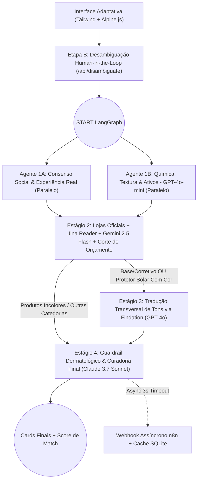

# Beauty AI Orchestrator

Sistema de recomendação hiperpersonalizada de cosméticos (**Skincare** e **Beleza & Maquiagem**) projetado sobre uma arquitetura de orquestração multi-agente (**LangGraph**) com execução paralela (**Fan-out / Fan-in**) e funil de custo computacional.

---

## 1. Arquitetura do Funil Multi-Agente (4 Estágios)



---

## 2. Estrutura do Projeto

```text
beauty-agent-orchestrator/
├── manage.py
├── requirements.txt
├── .env.example
├── beauty_orchestrator/
│   ├── __init__.py
│   ├── settings.py
│   ├── urls.py
│   ├── asgi.py
│   └── wsgi.py
├── recommender/
│   ├── __init__.py
│   ├── apps.py
│   ├── models.py                # Cache SQLite de avaliações (ProductReviewCache) e histórico (ConsultationLog)
│   ├── admin.py
│   ├── views.py
│   ├── schemas.py               # Pydantic v2 Discriminated Unions (SkincareRoutineJourney, SkincareSpecificJourney, MakeupJourney)
│   ├── api.py                   # Django Ninja API (/api/disambiguate, /api/recommend, /api/health)
│   ├── tests.py                 # Suite automatizada de testes
│   └── agents/
│       ├── __init__.py
│       ├── state.py             # OrchestratorState (LangGraph)
│       ├── tools.py             # Multi-Model Factory (Gemini, GPT, Claude), Tavily include_domains e Jina Reader
│       ├── disambiguator.py     # Etapa B: Desambiguação Human-in-the-Loop
│       ├── social_consensus.py  # Agente 1A (Consenso Social & Experiência de Uso)
│       ├── formulation_expert.py# Agente 1B (Formulação, Textura & Ativos - GPT-4o-mini)
│       ├── store_search_budget.py # Estágio 2 (Lojas Oficiais + Jina Reader + Gemini 2.5 Flash + Fallback 2 mais próximos)
│       ├── shade_translator.py  # Estágio 3 (Roteamento Condicional Transversal + Findation + Fallback Subtom)
│       ├── derm_curator.py      # Estágio 4 (Guardrail Dermatológico & Curadoria Final - Claude 3.7 Sonnet)
│       ├── graph.py             # Grafo compilado LangGraph (Fan-out / Fan-in)
│       └── webhook.py           # Disparo não bloqueante para n8n (timeout 3s + isolamento de exceções)
└── templates/
    └── index.html               # Interface Adaptativa de Fluxo Duplo (Tailwind CSS + Alpine.js via CDN)
```

---

## 3. Como Executar Localmente

```bash
# 1. Crie e ative um ambiente virtual Python 3.11+
python3 -m venv .venv
source .venv/bin/activate

# 2. Instale as dependências
pip install -r requirements.txt

# 3. Configure as variáveis de ambiente
cp .env.example .env

# 4. Execute as migrações do SQLite
python manage.py makemigrations
python manage.py migrate

# 5. Execute os testes automatizados
python manage.py test

# 6. Inicie o servidor de desenvolvimento
python manage.py runserver
```

Acesse `http://127.0.0.1:8000/` para utilizar a interface adaptativa ou `http://127.0.0.1:8000/api/docs` para explorar a documentação interativa OpenAPI (Django Ninja).
